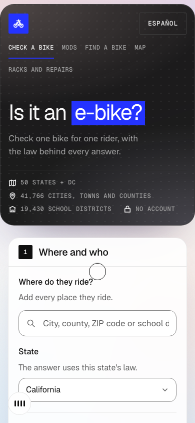
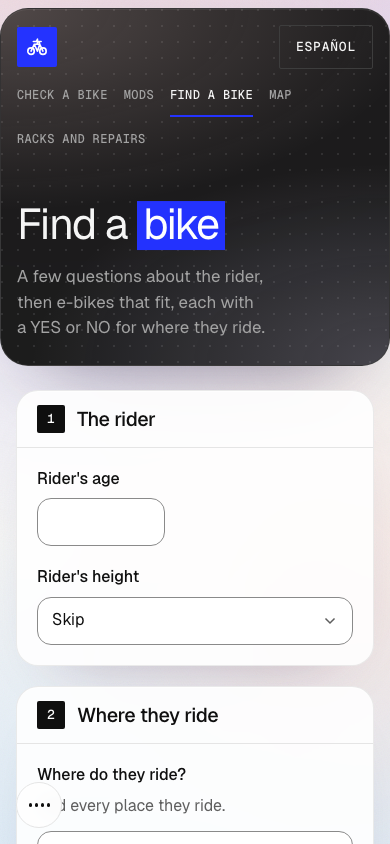

# Is it an e-bike?

[](https://github.com/Arnav66692/is-it-an-ebike/actions/workflows/ci.yml)
[](LICENSE)

Check one e-bike for one rider and the places they ride. The app reads bike specifications, asks the rider to review the facts, and applies a sourced rules table. Every answer includes its reasons and source links.

**[Try the app](https://is-it-an-ebike.vercel.app)** · [Results](RESULTS.md) · [Photo-model experiments](PILOT.md) · [Contributing](CONTRIBUTING.md)

Built for Neighborhood Hacks 2026. Next.js, React and TypeScript; English and Spanish; no account or paid AI API required.

<p>
  
  
</p>

## What it does

| Feature | What to expect |
| --- | --- |
| **Bike checker** | Enter specifications, paste a listing, or read a label with on-device OCR. Review and edit the extracted facts before checking. |
| **Place search** | Search US states, cities, counties, ZIP codes and school districts. Additional local records cover San Diego County; unchecked local rules are explicitly named. |
| **Mods check** | Assess proposed changes against the applicable rules. California research also includes dated changes and penalties. |
| **Bike finder** | Compare a sourced catalog by rider fit, use and budget. Prices and specifications are dated snapshots; links are not affiliate links. |
| **Map and routes** | Find bike parking and repair services, and explore routes with rule checks and range estimates. Map coverage and routing services have limits. |

The interface includes a 3D backdrop, an entrance screen and optional sound, with reduced-motion handling and a CSS fallback when WebGL is unavailable.

## How the answer is produced

1. **Read:** deterministic text parsing and on-device OCR extract specifications. An optional on-device OWLv2 detector helps identify pedals; it does not decide legality.
2. **Review:** extracted facts show their source wording and remain editable. There is no separate confirmation checkbox for each fact.
3. **Evaluate:** a deterministic engine applies the versioned state and local records, rider age, ride date and bike facts.
4. **Explain:** the answer lists reasons, requirements, sources, dates and coverage gaps. A NO can mean an explicit prohibition **or insufficient information to confirm permission**; the explanation distinguishes them.

## Evidence and limits

[RESULTS.md](RESULTS.md) is a dated snapshot of the source commit named in that report, with generated case counts, gates and test results. The CI badge above shows checks for the current branch. The tests compare the engine with an independently implemented reader of the same rule data. **Agreement with that table does not prove the table matches current law.** The rules were researched with AI assistance, not certified by a lawyer. Check the dates and linked primary sources; laws and local policies can change.

The [pilot](PILOT.md) reports failed photo-model attempts as well as the later passing experiment. Its small held-out set is not a guarantee for arbitrary photos or devices. The optional model download is about 194 MB and requires WebGPU support.

Spanish text is AI-assisted and **has not yet been reviewed by a fluent speaker**. Route estimates do not establish road safety, access permission or battery range. This project provides general information, not legal advice; confirm restrictions with the relevant authority before riding.

## Run locally

Use **Node.js 24** (see [.nvmrc](.nvmrc)) and npm. Python 3.12 runs the map-builder tests. No API keys are needed for the default configuration.

```bash
git clone https://github.com/Arnav66692/is-it-an-ebike.git
cd is-it-an-ebike
npm ci
npm run dev
```

Open [localhost:3000](http://localhost:3000). For a production build, run `npm run build` and then `npm start`. The default font setup downloads fonts at build time; map, routing, product pages and optional model downloads also need internet access.

```bash
npm run typecheck
npm run lint
npm test
python3 -m unittest discover -s scripts/map -p 'test_*.py'
npm run build
```

CI runs these checks on pushes to `main` and pull requests. Typechecking generates Next.js route types first, so it works before the first build. `npm run results` reruns the tests and updates the committed results report; review that diff before committing it.

## Privacy and hosting

Photos are processed on the device. The optional pedal detector downloads its model from Hugging Face and jsDelivr. Product URLs go to the app's server; the fetcher validates and pins public IP addresses at each redirect, caps response size and time, and does not persist listing content.

Place searches, map tiles, routing and catalog-photo requests contact third-party services. Route coordinates are sent to routing and geospatial providers; completed plans have a five-minute cache reuse window but may remain in server memory until eviction or process shutdown. The app has no account database. Browser preferences, in-memory caches and hosting-provider logs have separate lifetimes. See [deployment and privacy notes](docs/DEPLOYMENT.md).

## Explore the repository

| Location | Contents |
| --- | --- |
| `app/`, `components/` | Pages, API routes and interface |
| `lib/rules/`, `data/rules/`, `data/overlay.json` | Rules engine, sourced records and dated policy decisions |
| `lib/extract/`, `lib/photo/` | Specification parsing, guarded fetching and optional photo analysis |
| `lib/route/`, `lib/map/` | Route planning, estimates and map data |
| `tests/` | Golden cases, generated matrices, rendering checks and security regressions |
| [Place data](docs/PLACES_DATA.md), [map data](docs/MAP_DATA.md), [bike catalog](docs/BIKE_FINDER.md), [mods data](docs/MODS_DATA.md) | Sources, dates, rebuilding instructions and limitations |

## Authorship and licensing

Arnav Singh chose the problem, scope and policy decisions. Claude, through Claude Code, wrote the initial implementation, tests and Spanish text and assisted with research. OpenAI Codex assisted with release preparation, CI, documentation and security fixes. AI assistance is disclosed rather than presented as independent human verification.

Original code and original documentation are under the [MIT License](LICENSE). **MIT does not relicense third-party datasets, photos, source quotations, models or dependencies.** See [THIRD_PARTY_NOTICES.md](THIRD_PARTY_NOTICES.md) for those boundaries and source-specific terms.
